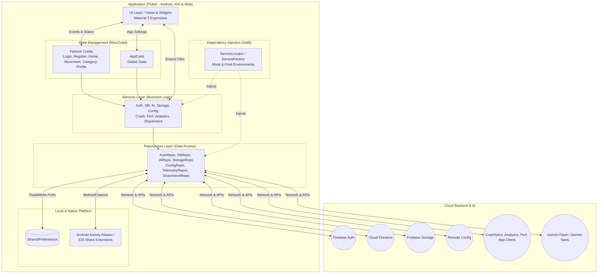

# Saver Expense Manager

Welcome to the comprehensive documentation for the **Saver Expense Manager** application. This guide covers the architecture, key Dart modules, native Android/iOS integrations, Firebase backend services, AI receipt extraction, and testing setup.

---

## 📑 Table of Contents

1. [Architecture](#%EF%B8%8F-architecture)
2. [App Core](#app-core)
   - [State Management](#1-state-management)
   - [Global Utilities, Routing & Themes](#2-global-utilities-routing--themes)
   - [Repositories & Services Layer](#3-repositories--services-layer)
   - [Native Share Integration (Android & iOS)](#4-native-share-integration-android--ios)
   - [UI Layer (View & Widgets)](#5-ui-layer-view--widgets)
3. [Feature Modules](#feature-modules)
   - [Login & Register](#login--register)
   - [Home](#home)
   - [Movement](#movement)
   - [Category](#category)
   - [Profile & Settings](#profile--settings)
4. [Localization (l10n)](#localization-l10n)
5. [Bootstrap & Entrypoint](#bootstrap--entrypoint)
6. [Packages & Data Models](#packages--data-models)
7. [Configuration & Testing](#configuration--testing)
8. [Security Assessment (MobSF)](#%EF%B8%8F-security-assessment-mobsf-static-analysis)

---

# 🏗️ Architecture

- **UI (Flutter Interface)**: Built with Material 3 Expressive (`expressive_kit`) and `hugeicons`, dispatching events to Cubits and interacting with Services.
- **State (Bloc/Cubit)**: Manages feature and global state cleanly with immutable `Equatable` states.
- **Local & Native Platform**: Uses `SharedPreferences` for local preferences and a dedicated `MethodChannel` bridge for Android/iOS Share Sheet integrations (no-op on Web).
- **Services & Repositories**: Follows a strict Repository Pattern connected via `get_it` and `ServiceFactory` (`Environment.prod` and `Environment.mock`).
- **Backend & AI**: Firebase powers Auth, Cloud Firestore, Cloud Storage, Remote Config, App Check, Crashlytics, Performance, and Analytics; Gemini AI (`firebase_ai` cloud + `gemini_nano_android` on-device fallback) powers receipt extraction and ant-expense recommendations.

---

## App Core

### 1. State Management

| File                             | Role                                                                                          |
|----------------------------------|-----------------------------------------------------------------------------------------------|
| **lib/app/cubit/app_cubit.dart** | Manages **global app state**: locale, theme mode, base color, and font family persisted via `LocalStorageService`. |
| **lib/app/cubit/app_state.dart** | Immutable state variables serving core app configuration. Supports `copyWith`. |

---

### 2. Global Utilities, Routing & Themes

| File                                     | Role                                                                                                                                      |
|------------------------------------------|-------------------------------------------------------------------------------------------------------------------------------------------|
| **lib/app/global/app_routes.dart**       | Defines the `GoRouter` navigation graph (`login`, `register`, `home`, `settings`, `movement`, `category`, `profile`), auth redirects, route analytics observer, and a mobile `onException` guard against external share URIs. |
| **lib/app/global/app_dependencies.dart** | Configures `get_it` lazy singletons and `ServiceFactory` for `Environment.prod` and `Environment.mock` (including Web-safe no-op repositories for Crashlytics and Share Intents). |
| **lib/app/global/app_variables.dart**    | App-wide constants, allowed attachment extensions (`pdf`, `png`, `jpg`, `jpeg`), timeouts, colors, company logos, and enums. |
| **lib/app/global/app_functions.dart**    | Shared business helpers: AI receipt extraction (`buildMovementFromFile`), ant-expense recommendations, chart/trend builders (monthly & yearly), connectivity checks, and snackbars. |
| **lib/app/global/app_extensions.dart**   | Utility extensions across Dart/Flutter types (e.g., `HexColor`). |
| **lib/app/helpers/***                    | Platform/model helpers such as `model_type_helper.dart`. |

Themes are powered by `expressive_kit` (`ExpressiveTheme.light` and `ExpressiveTheme.dark`) configured dynamically in `lib/app/view/app_view.dart` from `AppCubit`.

---

### 3. Repositories & Services Layer

The application implements a Repository Pattern connected via Dependency Injection (`get_it` & `ServiceFactory`), separating raw platform/API access from business logic and enabling isolated unit and widget testing.

| Layer | Responsibility | Key Files |
|-------|----------------|-----------|
| **Repositories** (`lib/app/repositories/`) | Raw data access, Firebase SDKs, and native platform channels (`Mock` & `Prod` implementations). | `auth_repository.dart`, `database_repository.dart`, `remote_storage_repository.dart`, `ai_repository.dart`, `remote_config_repository.dart`, `local_storage_repository.dart`, `crash_repository.dart`, `performance_repository.dart`, `analytics_repository.dart`, `share_intent_repository.dart` |
| **Services** (`lib/app/services/`) | Core business logic, telemetry tracing, and clean APIs consumed by Cubits and Views. | `auth_service.dart`, `database_service.dart`, `remote_storage_service.dart`, `ai_service.dart`, `remote_config_service.dart`, `local_storage_service.dart`, `crash_service.dart`, `performance_service.dart`, `analytics_service.dart`, `share_intent_service.dart` |

**Key Capabilities:**
- **Infrastructure & Telemetry**: `CrashService`, `PerformanceService`, and `AnalyticsService` for Firebase Crashlytics, Performance traces, and Analytics events.
- **Config & Local Storage**: `LocalStorageService` (`SharedPreferences`) and `RemoteConfigService` (Firebase Remote Config prompts, initial tab, summary lookback ranges, pagination limits).
- **Authentication**: `AuthService` supporting Email/Password and Google Sign-In, account linking/unlinking, and account deletion.
- **Data & Remote Storage**: `DatabaseService` (Firestore CRUD & paginated streams) and `RemoteStorageService` (traced Firebase Storage upload, download, and deletion).
- **AI**: `AiService` combining cloud inference (`Gemini Flash` via `firebase_ai`) with offline on-device fallback (`Gemini Nano` via `gemini_nano_android`).
- **Native Share Handling**: `ShareIntentService` receiving files shared from external apps on Android and iOS (`MockShareIntentRepository` no-op on Web).

---

### 4. Native Share Integration (Android & iOS)

Users on **Android** and **iOS** can share any supported receipt file (`pdf`, `png`, `jpg`, `jpeg`, defined in `AppVariables.allowedExtensions`) from external apps (Files, Photos, Banking apps, Messaging apps, etc.) directly into Saver with **two dedicated options**:
- **Add expense** (`EXPENSE`)
- **Add income** (`INCOME`)

Both options are localized across all 6 supported languages (`en`, `es`, `it`, `de`, `fr`, `pt`) and work in both **cold start** and **warm start**.

- **Android**:
  - `android/app/src/main/AndroidManifest.xml`: Uses `launchMode="singleTask"` on `MainActivity` and defines two `<activity-alias>` entries (`.ShareExpenseActivity` and `.ShareIncomeActivity`) for `ACTION_SEND` restricted to `application/pdf`, `image/png`, `image/jpeg`, and `image/jpg`.
  - `android/app/src/main/kotlin/com/pmorales/saver/expense/manager/MainActivity.kt`: Intercepts share intents before Flutter's deep linking handler (preventing `content://` URIs from reaching `GoRouter`), copies the stream into `cacheDir/shared_files/`, and delivers `{path, name, movementType}` to Flutter via `MethodChannel` (`com.pmorales.saver.expense.manager/share`).
  - Localized labels live in `android/app/src/main/res/values*/strings.xml`.
- **iOS**:
  - Two embedded Share Extensions (`ios/ShareExpenseExtension/` and `ios/ShareIncomeExtension/`) with `NSExtensionActivationRule` filtering for `com.adobe.pdf`, `public.png`, and `public.jpeg`, and localized `InfoPlist.strings` (`en`, `es`, `it`, `de`, `fr`, `pt`).
  - Flavor-aware App Groups (`group.com.pmorales.saver.expense.manager`, `.stg`, `.dev`) and custom URL schemes (`saver-share`, `saver-share-stg`, `saver-share-dev`) configured across `production`, `staging`, and `development`.
  - `ios/Runner/AppDelegate.swift`: Registers `ShareIntentPlugin` via `FlutterImplicitEngineDelegate` to handle both URL callbacks and App Group pending metadata.
- **Web**: Completely unaffected; `ServiceFactory.getShareIntentRepository` returns `MockShareIntentRepository` when `kIsWeb` is `true`.

---

### 5. UI Layer (View & Widgets)

#### View

| File                               | Role                                                                                                |
|------------------------------------|-----------------------------------------------------------------------------------------------------|
| **lib/app/view/app_page.dart**     | Top-level widget providing `AppCubit` to the widget tree.                                           |
| **lib/app/view/app_view.dart**     | Consumes `AppCubit`, configures `MaterialApp.router` with `ExpressiveTheme`, `GoRouter`, and l10n. |

#### Widgets

| File                          | Role                                                                                                               |
|-------------------------------|--------------------------------------------------------------------------------------------------------------------|
| **lib/app/widgets/***         | Shared UI components: `AppLoader` (mounted-safe root navigator dialog), `AppFileField`, `AppTextField`, `AppDateField`, `AppDropdownField`, `AppAlertDialog`, `MonthSelector`, `MonthRangeSelector`, `MonthPicker`, Syncfusion charts (`DoughnutCircularChart`, `LinearChart`, `TotalSpentChart`), `MovementsList`, and `CategorySummaryCard`. |
| **lib/app/animations/***      | Custom animated category icons and circular loading indicator (`CircularLoadingAnimation`).                        |

---

## Feature Modules

Each feature follows a standard Bloc/Cubit architecture:
1. **Barrel** file exporting module components.
2. **Cubit**: `feature_cubit.dart` + `feature_state.dart`.
3. **Page**: Stateless widget providing the Cubit and loading streams.
4. **View**: Reactive UI widget consuming state from the Cubit.

---

### Login & Register

- **lib/login/***  
- **lib/register/***  

**Features:**  
Handles user onboarding, Email/Password and Google Sign-In, form validation, and account registration via `AuthService`.

---

### Home

- **lib/home/***  

**Highlights:**  
- Four main tabs managed by `HomeCubit`: **Expenses** (`0`), **Movements** (`1`), **Summary** (`2`, supporting both **monthly** and **yearly** comparison periods), and **Income** (`3`).
- `AddMovementBottomSheet` supports adding movements via **File pick** (`handleFilePick`), **Document scan** (`handleDocumentScan`, mobile only via `cunning_document_scanner`), or **Manual entry**.
- `_ShareIntentListener` (mobile only) listens for incoming shared files from `ShareIntentService`, clears any open sub-routes, switches to the **Expenses** (`0`) or **Income** (`3`) tab, and executes `AddMovementBottomSheet.handleFilePick` so that pressing back from `MovementView` returns directly to the selected home tab.
- Uses `syncfusion_flutter_charts` for category breakdowns and income/expense/balance trends.

---

### Movement

- **lib/movement/***  

**Capabilities:**  
- Full create/edit/delete form for `Movement` entities (title, description, date with old-date warning dialog, category, amount, company, and attachments) persisted in Firestore.
- Supports AI-assisted receipt parsing (from shared files, picked files, or scanned documents) running Storage upload and Gemini extraction in parallel, with automatic Storage rollback if AI extraction or upload fails.
- **Automatic silent attachment cleanup**: `PopScope` in `MovementView` combined with `MovementCubit.discardUnsavedAttachments()` automatically deletes any uploaded attachments from Firebase Storage in the background—silently and without blocking navigation—whenever the user navigates back from a **new movement** (`MovementScreenType.add`) without saving (whether the attachment came from sharing a file, picking a file, scanning a receipt, or attaching manually). Saved movements and edits (`MovementScreenType.edit`) are never affected.

---

### Category

- **lib/category/***  

**Features:**  
- Detailed category view with **Trend** charts and **Movements** history filtered by customizable month ranges.

---

### Profile & Settings

- **lib/profile/***  
- **lib/settings/***  

**Controls:**  
- **Profile**: Manages display name, avatar, linked auth providers (Google / Email), logout, and full account deletion with Firebase backend cleanup.
- **Settings**: Configures appearance (theme mode, Material 3 Expressive base color, font family), app language, AI model diagnostics (cloud vs. local Gemini Nano status), and app version metadata.

---

## Localization (l10n)

| File                               | Role                                                  |
|------------------------------------|-------------------------------------------------------|
| **lib/l10n/arb/app_en.arb**        | English string dictionary.                            |
| **lib/l10n/arb/app_es.arb**        | Spanish translation map.                              |
| **lib/l10n/arb/app_it.arb**        | Italian translation map.                              |
| **lib/l10n/arb/app_de.arb**        | German translation map.                               |
| **lib/l10n/arb/app_fr.arb**        | French translation map.                               |
| **lib/l10n/arb/app_pt.arb**        | Portuguese translation map.                           |
| **lib/l10n/gen/***                 | Dynamically generated localization delegates.         |

Native Android (`values*/strings.xml`) and iOS (`Share*Extension/*.lproj/InfoPlist.strings`) share targets mirror all 6 languages.

---

## Bootstrap & Entrypoint

| File                          | Role                                                                                                                                                  |
|-------------------------------|-------------------------------------------------------------------------------------------------------------------------------------------------------|
| **lib/bootstrap.dart**        | Configures `FlutterError.onError`, `PlatformDispatcher.instance.onError`, `AppBlocObserver`, edge-to-edge UI on mobile, and invokes `runApp()`.       |
| **lib/main.dart**             | 1. Initializes Flutter bindings & Firebase.   2. Sets up `setupServiceLocator(Environment.prod)`.   3. Activates `FirebaseAppCheck` and initializes `AuthService`, `LocalStorageService`, `RemoteConfigService`, `AiService`, and `ShareIntentService` in parallel.   4. Launches the app via `bootstrap`. |

---

## Packages & Data Models

Saver Expense Manager synchronizes financial data through Firebase while maintaining immutable local models (`Equatable`).

### Data Models

- **lib/app/models/app_user.dart**: Authenticated user profile and linked providers.
- **lib/app/models/movement.dart**: Individual financial transaction (amount, date, title, description, company, category, attachments), including `Movement.fromAiService`.
- **lib/app/models/category.dart**: Category metadata and `CategoryType` (`expense` / `income`).
- **lib/app/models/shared_file.dart**: Incoming shared file payload (`path`, `name`, `movementType`, optional `bytes`) with `AppVariables.allowedExtensions` validation.
- **lib/app/models/prompt_part.dart**: Multimodal input abstraction (text / file bytes) for remote and local Gemini models.
- **lib/app/models/category_data.dart**, **category_expense_data.dart** & **linear_chart_data.dart**: Structured models for Syncfusion charts.
- **lib/app/models/app_route_observer.dart**: `NavigatorObserver` logging screen views to `AnalyticsService`.

---

## Configuration & Testing

### Configuration (`pubspec.yaml`)

- **SDK Constraints**: Dart `>=3.14.0 <4.0.0` (using Dart 3.14 unnamed constructor syntax `const new(...)`) and Flutter `>=3.50.0`.
- **Flavors**: `production`, `staging`, and `development` configured for both Android (Gradle `productFlavors`) and iOS (Xcode schemes & build configurations).
- **Core Packages**: `flutter_bloc`, `equatable`, `get_it`, `go_router`, `expressive_kit`, `hugeicons`, `syncfusion_flutter_charts`, `file_picker`, `cunning_document_scanner`, `firebase_core`, `firebase_auth`, `cloud_firestore`, `firebase_storage`, `firebase_remote_config`, `firebase_app_check`, `firebase_crashlytics`, `firebase_analytics`, `firebase_performance`, `firebase_ai`, and `gemini_nano_android`.
- **Static Analysis**: Enforced with `very_good_analysis`.

### Testing Architecture

The project provides comprehensive unit and widget tests backed by `get_it` dependency injection:
- **Mock Environments**: `Environment.mock` in `ServiceFactory` swaps production repositories for in-memory mocks (`MockAuthRepository`, `MockDatabaseRepository`, `MockShareIntentRepository`, etc.) without network or platform dependencies.
- **Coverage**: Includes Cubit (`bloc_test`), Repository, Service, Model, Widget, and View tests (including cold/warm share intent flows, silent attachment cleanup on unsaved exit, and unmounted loader safety) using `mocktail`.
- **CI/CD**: Automated analysis and test suites run on pull requests via `beta.yaml`.

---

## 🛡️ Security Assessment (MobSF Static Analysis)

The application undergoes continuous static application security testing (SAST) using **Mobile Security Framework (MobSF)** aligned with the **OWASP Mobile Application Security Verification Standard (MASVS)**.

| Category | Status | Details |
| :--- | :---: | :--- |
| **Android Manifest** |  | Data backup disabled (`allowBackup="false"`), cleartext traffic blocked (`usesCleartextTraffic="false"`). |
| **Exported Components** |  | Share aliases (`.ShareExpenseActivity`, `.ShareIncomeActivity`) restricted to allowed MIME types; Firebase Auth & Google Play Services endpoints verified. |
| **Code & Storage Quality** |  | R8 obfuscation enabled, scoped storage compliance, automatic cleanup of cached shared files and unsaved Storage attachments. |
| **Privacy & Telemetry** |  | Strictly standard Google Crashlytics, Analytics & App Check complying with Play Store Data Safety. |

 

<b>🔍 View Detailed Audit & Remediation Findings</b>

### 1. Android Manifest Hardening
* **Application Data Backup**: Explicitly disabled (`android:allowBackup="false"`), preventing unauthorized local data extraction via ADB.
* **Network Security**: Strict TLS enforcement enabled (`android:usesCleartextTraffic="false"`), completely prohibiting insecure HTTP transmissions.
* **Component Verification**: 
  - `.ShareExpenseActivity` & `.ShareIncomeActivity`: Exported `<activity-alias>` targets strictly scoped to `ACTION_SEND` for `application/pdf`, `image/png`, `image/jpeg`, and `image/jpg`, validated natively and in Dart before processing.
  - `GenericIdpActivity` & `RecaptchaActivity` (`com.google.firebase.auth`): Mandatory OAuth browser delegates for secure Firebase Authentication flows.
  - `RevocationBoundService` (`com.google.android.gms.auth`): Standard Google Sign-In account revocation handler.
  - `ProfileInstallReceiver` (`androidx.profileinstaller`): Jetpack runtime optimization baseline profile installer.

### 2. Plugins & Source Code Integrity
* **Temporary Files & Scoped Storage**: Document scanning (`cunning_document_scanner`) and Android/iOS Share Intent handlers copy transient receipt files only to app-isolated cache / App Group directories (`shared_files/`) and delete them immediately after reading.
* **Orphan Attachment Prevention**: Unsaved new movements automatically delete their uploaded Firebase Storage attachments silently in the background when the user navigates back.
* **Cryptography**: Flagged SHA-1 and MD5 occurrences were reviewed and verified as non-cryptographic checksum algorithms used internally by the Flutter engine for asset resolution and font caching.
* **Code Obfuscation**: Android R8/ProGuard minification (`isMinifyEnabled = true`) is active in release builds to protect business logic against reverse engineering.

### 3. Trackers & Privacy
* **Telemetry**: Only official Google Firebase Analytics, Crashlytics, Performance, and App Check libraries are embedded.
* **Data Safety**: Fully compliant with Google Play Data Safety requirements; no user financial identifiers or PII are collected or transmitted to external advertising networks.

---

> **Enjoy building and extending the Saver Expense Manager app!**
